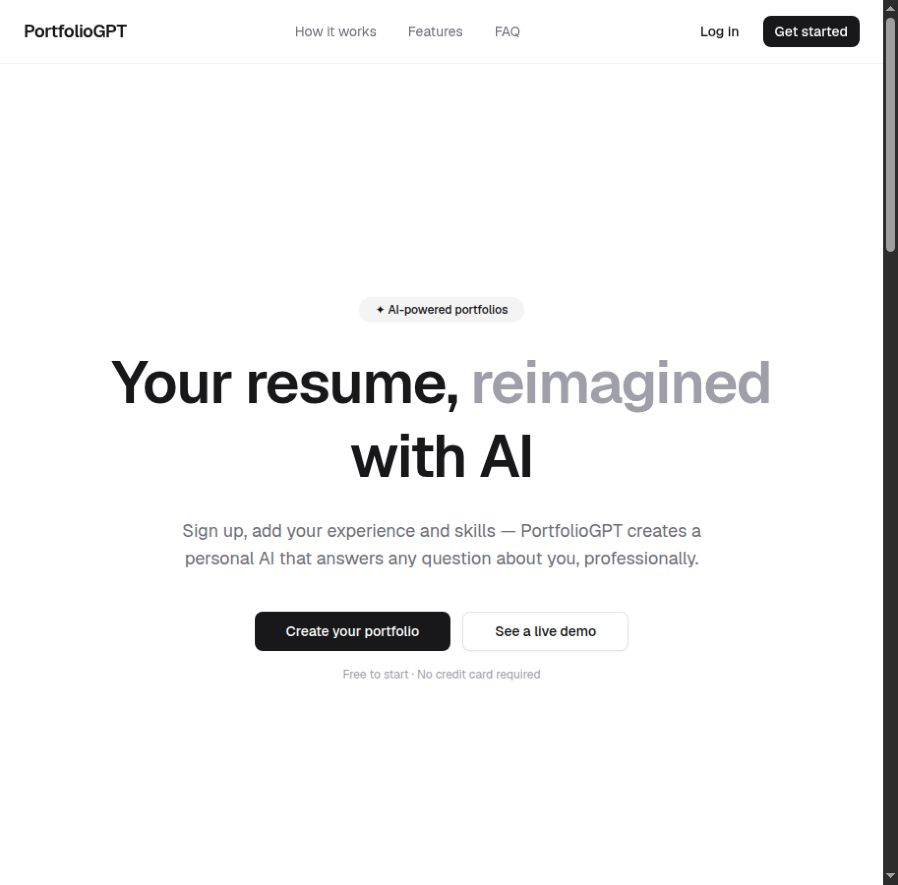
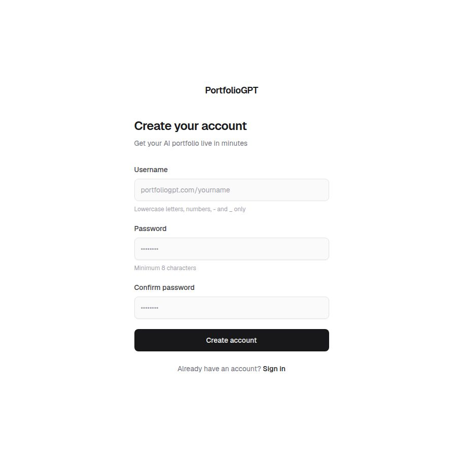
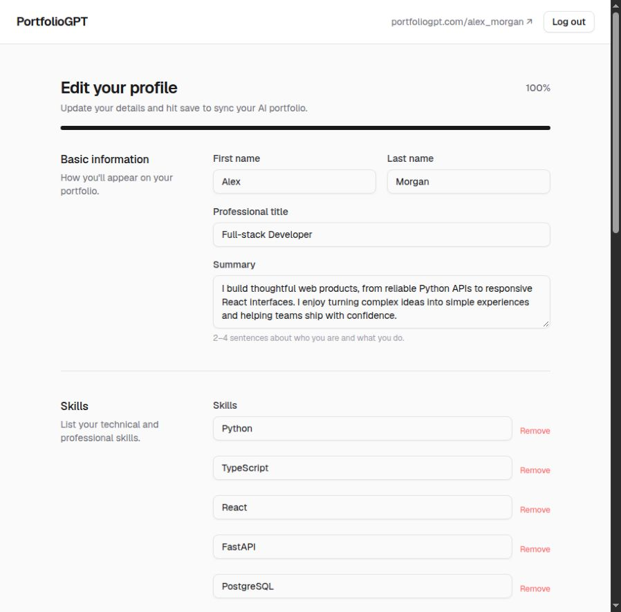
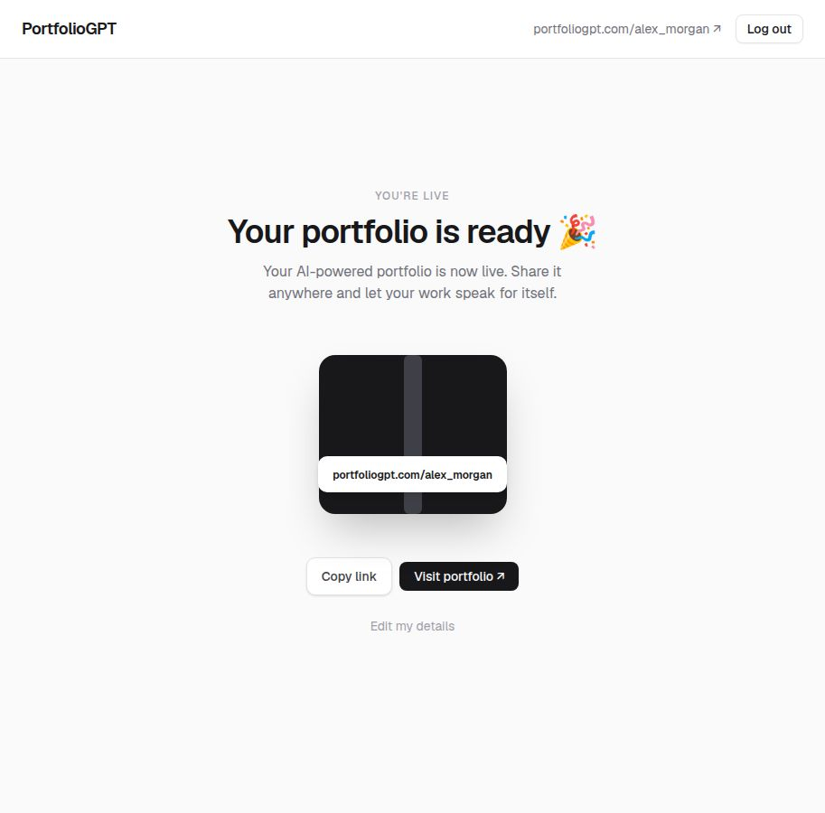
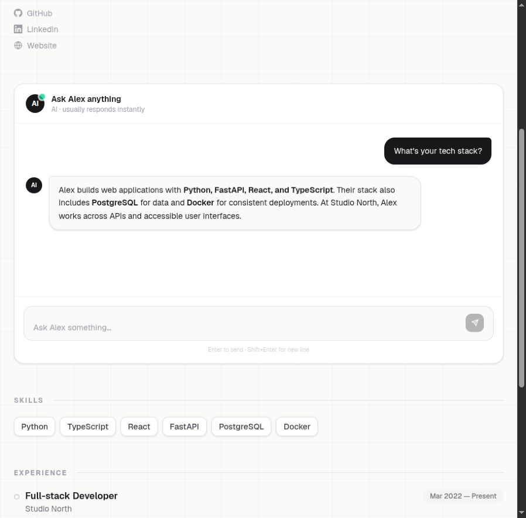
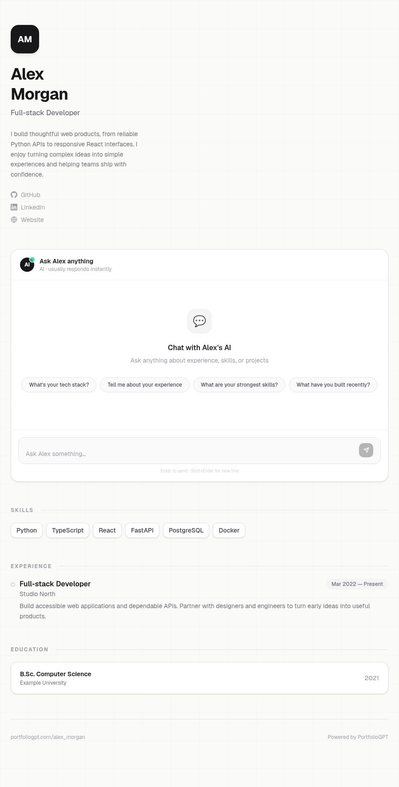

# 🧠 PortfolioGPT

**A personal portfolio that visitors can talk to.**

Turn your skills and experience into a shareable profile with an AI assistant.
Visitors explore your background and ask questions grounded in your portfolio
through retrieval-augmented generation (RAG).

**Sign up → Build your profile → Share your link → Start a conversation**

## ✨ Features

- **Your own page** at `/<username>`, with skills, experience, education and links.
- **AI portfolio chat** with semantic retrieval and saved conversation history.
- **Profile dashboard** to edit your information and refresh its embeddings.
- **Account authentication** with bcrypt password hashing and RSA-signed JWTs.
- **Flexible AI providers** with separate OpenAI-compatible chat and embedding endpoints.
- **Responsive UI** with animations and Markdown chat replies.

## 📸 Product walkthrough

Screenshots show the actual frontend. Alex Morgan's profile and chat reply are
fictional examples supplied by a mock API; no live backend or model response is shown.



| 🪪 1. Create your account | 📝 2. Build your profile |
| --- | --- |
| Choose your public username. | Add your background and skills. |
|  |  |

| 🔗 3. Publish and share | 💬 4. Let visitors ask questions |
| --- | --- |
| Copy your personal portfolio link. | Explore your experience through chat. |
|  |  |

<details>
<summary>👀 See the complete public portfolio</summary>



</details>

## 🛠️ Tech stack

| Layer | Built with |
| --- | --- |
| Frontend | Next.js 16 · React 19 · TypeScript · Tailwind CSS 4 · Radix UI · Framer Motion |
| Backend | FastAPI · Pydantic · SQLModel / SQLAlchemy · Alembic |
| Infrastructure | PostgreSQL · Milvus · Redis · MinIO |
| AI | OpenAI Python SDK · Configurable chat and embedding providers |

## 🚀 Run locally

**Requirements:** Node.js 20.9+ (`.nvmrc` selects 24), Python 3.12, Docker,
PostgreSQL, Redis and AI provider credentials. The backend also requires access
to the original private `ec_*` packages.

Start the frontend:

```bash
cd frontend
npm ci
cp .env.example .env.local
npm run dev
```

Open **http://localhost:3000**. Account, profile and chat features require the
backend; set `NEXT_PUBLIC_API_BASE_URL` in `.env.local` if it differs from
`http://localhost:8080`.

Backend instructions and API details are included below. A standalone
[setup guide](docs/SETUP.md) is also available.

## ⚙️ Technical reference

<details>
<summary><strong>📦 Architecture and project structure</strong></summary>

Profile updates refresh Milvus embeddings; chat retrieves portfolio-scoped context
and uses the configured model to answer. PostgreSQL stores profiles and messages.

```text
backend/
  app/
    api/                 # Health and versioned routes
    core/                # Settings, dependencies and service wiring
    db/                  # Models, repositories and portfolio migration chain
    migrations/          # Older migration chain
    rsa/                 # Locally generated JWT signing keys
    services/            # Auth, portfolio, chat/RAG, providers and file storage
  docker-compose.yml     # Milvus, etcd, MinIO and Attu
  .env.example
  requirements.txt
  requirements-private.txt
frontend/
  src/app/               # Landing, auth, dashboard and public pages
  src/components/
  src/context/           # Authentication state
  src/lib/               # API client and utilities
  .env.example
```

</details>

<details>
<summary><strong>🔧 Backend setup, infrastructure and configuration</strong></summary>

Run from the repository root with Python 3.12:

```bash
python3.12 -m venv backend/.venv
source backend/.venv/bin/activate
python -m pip install -r backend/requirements.txt
# Configure your authorized ec_* registry before this step:
python -m pip install -r backend/requirements-private.txt
cp backend/.env.example backend/.env
```

The external `ec_*` packages are not bundled. Their installed versions are listed
in `backend/requirements-private.txt`; public dependencies alone cannot start the API.

Set database, Redis, MinIO, logging and AI provider values in `backend/.env`.
Both chat and embeddings have independent URLs, credentials and model names.
Legacy integration variables and `POSTGRES_COMMERCE_*` remain required by the
service wiring; both PostgreSQL clients can use the same local database.

Generate the RSA keys read by settings at startup:

```bash
mkdir -p backend/app/rsa
openssl genpkey -algorithm RSA -pkeyopt rsa_keygen_bits:2048 -out backend/app/rsa/private.key
openssl rsa -pubout -in backend/app/rsa/private.key -out backend/app/rsa/public.pem
chmod 600 backend/app/rsa/private.key
```

Each installation needs its own keys. `.gitignore` excludes environment secrets,
keys, request scratch files, editor settings, dependencies and generated output.

```bash
docker compose -f backend/docker-compose.yml up -d
```

| Included service | Local ports |
| --- | --- |
| Milvus | `19530` (vector database), `9091` (management) |
| etcd | `2379` |
| MinIO | `9000` (API), `9001` (console) |
| Attu | `8000` |

Provision **PostgreSQL and Redis separately**. Compose does not start the API or
frontend, has no persistent volumes, and uses development credentials that must
be changed for shared deployments.

Create the database/user matching `.env`. **Review migrations before applying:**
the portfolio chain creates `chat`, then expects `portfolio`; a fresh
`alembic upgrade head` is not verified. Current models are in
`backend/app/db/models.py`, with migrations in `backend/app/db/migrations`.

From the repository root, in the activated environment:

```bash
set -a
source backend/.env
set +a
cd backend/app
uvicorn main:app --host 127.0.0.1 --port 8080 --reload
```

Settings read process environment variables, so export `.env` explicitly.
Swagger UI: **http://localhost:8080/docs**, with an empty `API_SERVICE_PREFIX`.
The frontend's `NEXT_PUBLIC_API_BASE_URL` is public and baked into the browser
bundle: set it before building and never place secrets in it.

</details>

<details>
<summary><strong>🔌 API endpoints and deployment notes</strong></summary>

Paths assume an empty `API_SERVICE_PREFIX`.

| Method | Path | Purpose |
| --- | --- | --- |
| POST | `/v1/users/signup` | Create an account and return tokens |
| POST | `/v1/users/signin` | Authenticate and return tokens |
| GET | `/v1/portfolio/me/portfolio` | Read your portfolio; Bearer token required |
| PATCH | `/v1/portfolio/me/portfolio` | Create/update and re-index; Bearer token required |
| GET | `/v1/portfolio/{username}` | Read a public profile |
| POST | `/v1/chat/{portfolio_username}/chat` | Ask about a portfolio |

Before deployment, configure explicit CORS origins: the API currently combines
wildcard origins with credentials. Authentication and chat session behavior need
review. Full backend startup also depends on the external packages, reachable
infrastructure, valid model credentials and a reviewed migration path.

</details>

## 🧪 Frontend checks

From `frontend/`:

```bash
npx tsc --noEmit
npm run lint
npm run build
```

## 🚧 Project status

An existing development project: private backend dependencies and a migration
inconsistency prevent a turnkey fresh setup. Existing lint issues remain;
[setup notes](docs/SETUP.md#current-limitations) cover deployment limitations.
`portfoliogpt.com` in the UI is branding, not a verified live deployment.
